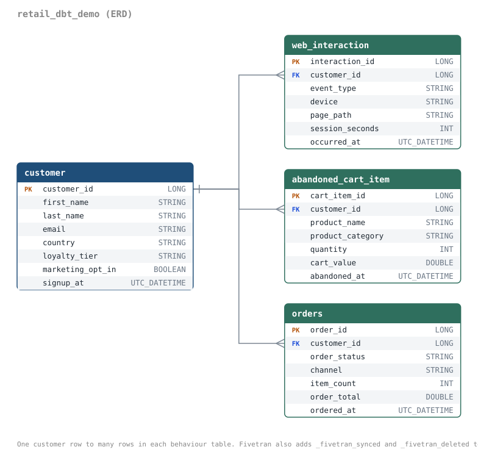
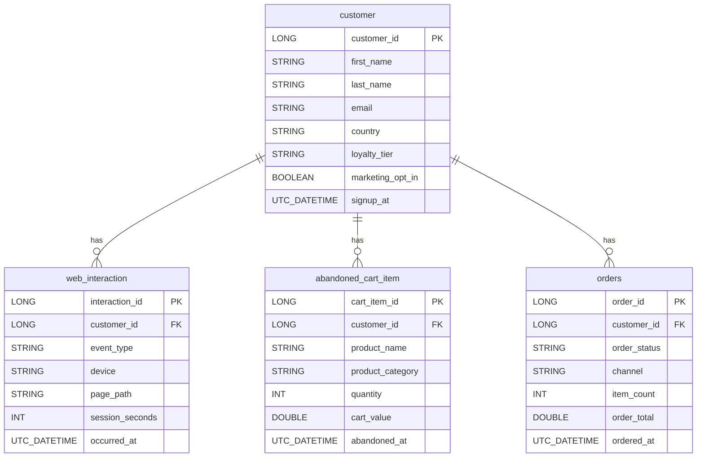

# retail demo data connector (Fivetran Connector SDK)

A standalone connector that **only generates synthetic data**. It has no dependency on dbt,
a warehouse, or any other folder, so you can download this folder on its own, test it, and
deploy it.

## What it generates (schema `retail_dbt_demo`)



| Table | Role |
|---|---|
| `customer` | Reference object. One row per entity, unique `customer_id`. Written **once**, on the first sync. |
| `web_interaction`, `abandoned_cart_item`, `orders` | Behaviour tables. Every row carries `customer_id`. |

**Sync 1 (history).** Creates the configured number of `customer` rows. For each one, every
behaviour table gets a random number of rows between its configured min and max (inclusive),
all keyed to that `customer` row.

**Sync 2 onwards.** Each sync randomly picks **one or two** behaviour tables and appends new
rows to them, spread across existing `customer` rows. `customer` and the unpicked table(s) get
nothing. The connector logs which tables were chosen.

<details><summary>Mermaid source (also in <code>docs/erd.mmd</code>)</summary>



</details>

## Configuration (`configuration.json`)

| Key | Value |
|---|---|
| `customer_count` | 100 |
| `web_interaction_min` | 5 |
| `web_interaction_max` | 30 |
| `abandoned_cart_item_min` | 0 |
| `abandoned_cart_item_max` | 4 |
| `orders_min` | 0 |
| `orders_max` | 5 |
| `incremental_min` | 5 |
| `incremental_max` | 25 |
| `seed` | 42 |

`incremental_min` / `incremental_max` set how many rows are appended to each chosen table per
sync. The same `seed` reproduces the same data and the same sequence of table choices. Values
are strings because the Connector SDK requires that. The `customer` count is fixed when sync 1
runs; to resize, run `fivetran reset` or recreate the connection.

## Run it

```bash
pip install fivetran-connector-sdk
fivetran debug --configuration configuration.json     # one sync per run; repeat for later syncs
```

State and a local DuckDB warehouse are written to `files/` (schema `tester`). Inspect with
`duckdb -ui files/warehouse.db`. Delete `files/` to start over.

## Test it

```bash
python tests/test_connector.py
```

Runs the history load plus 3 more syncs in a temporary copy (your folder is not
touched) and checks: reference row count and key uniqueness, every per-row min/max range,
no orphaned foreign keys, 1 or 2 tables per later sync (never `customer`), incremental volume
within range, and that the same seed repeats the same choices.

## Deploy to Fivetran

```bash
fivetran deploy --api-key <BASE64_API_KEY> --destination <DESTINATION_NAME> \
  --connection retail_dbt_demo --configuration configuration.json
```

The connection name becomes the destination schema, so `retail_dbt_demo` is the schema downstream
tools read from. Then trigger syncs from the Fivetran dashboard or API: the first is the
history load, every later one an incremental append.

No third-party packages are needed, so there is deliberately no `requirements.txt`. The connector
uses only the standard library and the SDK, which Fivetran's runtime already provides. If you add
a dependency, create a `requirements.txt` listing it.
